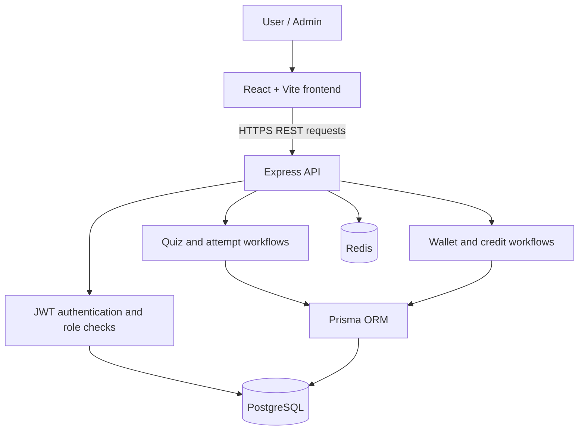
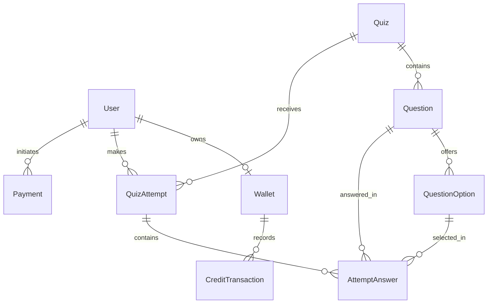
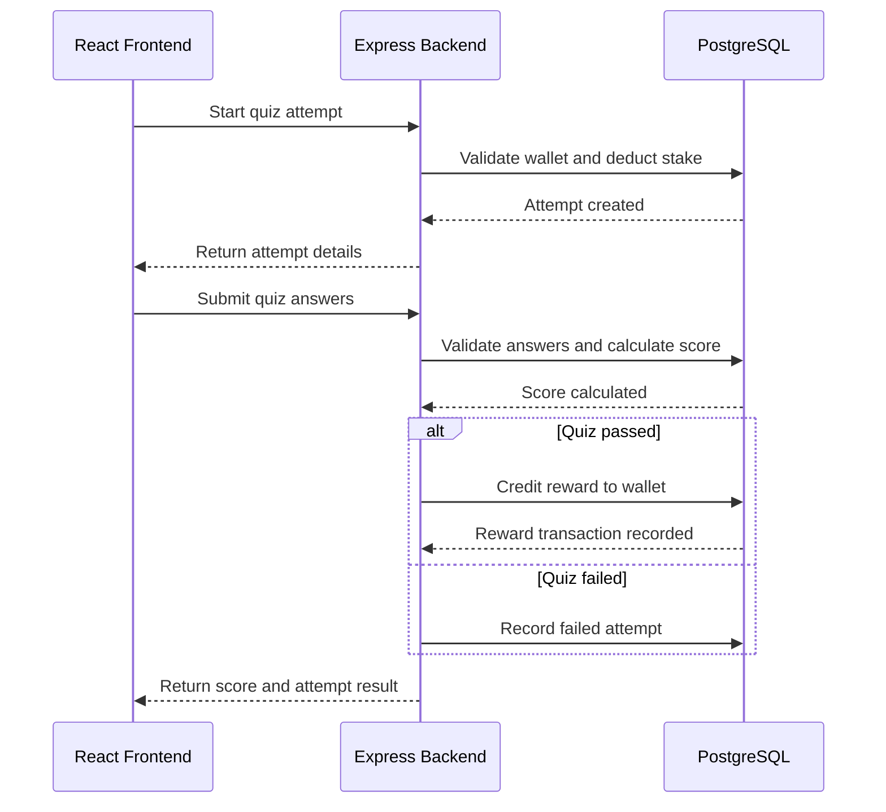

# Quiz Credit Platform

A full-stack quiz application where users spend virtual credits to attempt quizzes, earn rewards for passing, and review their wallet activity. Administrators manage quizzes and questions through a dedicated dashboard.

## Live application

- **Frontend:** https://quiz-credit-frontend.onrender.com
- **Backend API:** https://quiz-credit-app.onrender.com
- **Interactive API documentation:** https://quiz-credit-app.onrender.com/api-docs

> Free-tier services may take some time to respond after periods of inactivity.

## Features

### User experience
- Register and log in with JWT-based authentication.
- Receive an initial **500-credit** wallet balance at registration.
- Browse published quizzes and view quiz details.
- Start a quiz by staking credits; submit answers and receive a score and pass/fail result.
- Earn quiz rewards on qualifying attempts.
- View attempt history, wallet balance, and credit transaction history.
- Purchase virtual credits through a **mock payment** flow (no real payment processing).

### Administration
- Create, update, publish, and archive quizzes.
- Manage questions and answer options for draft quizzes.
- Configure quiz stakes, rewards, and passing scores.
- Access role-restricted administration endpoints and dashboard.

### Backend engineering
- REST API built with Express and TypeScript.
- PostgreSQL persistence using Prisma ORM.
- Redis integration.
- Wallet transaction ledger and database uniqueness constraints.
- Idempotency handling for quiz starts and mock credit purchases.
- Swagger/OpenAPI API documentation.
- Docker configuration for local development and deployment.

## Technology stack

| Layer | Technology |
| --- | --- |
| Frontend | React, TypeScript, Vite, Tailwind CSS, TanStack Query |
| Backend | Node.js, Express, TypeScript |
| Database | PostgreSQL |
| ORM | Prisma |
| Cache / infrastructure | Redis |
| Authentication | JWT |
| API documentation | Swagger / OpenAPI |
| Containers | Docker, Docker Compose |
| Hosting | Render |

## High-level design (HLD)



**Request flow:** The frontend calls the REST API. The backend authenticates requests, applies business rules, and persists application data through Prisma to PostgreSQL. Redis is connected as an additional infrastructure component.

## Database design

The Prisma schema defines **nine models**:

| Model / table | Purpose | Key relationships and constraints |
| --- | --- | --- |
| `User` | Accounts and roles (`USER`, `ADMIN`) | Unique email; optional one-to-one wallet; one-to-many attempts and payments |
| `Wallet` | Current credit balance | Unique `userId` links each wallet to one user; default balance 500 |
| `CreditTransaction` | Auditable record of credit changes | Belongs to wallet; stores type, amount, balance after transaction, and optional reference; unique `(walletId, type, referenceId)` |
| `Quiz` | Quiz metadata and lifecycle | Status `DRAFT`, `PUBLISHED`, or `ARCHIVED`; has many questions and attempts |
| `Question` | Quiz questions and point values | Belongs to quiz; has many answer options and submitted answers |
| `QuestionOption` | Available choices and correct-answer indicator | Belongs to question; referenced by submitted answers |
| `QuizAttempt` | User participation and outcomes | Belongs to user and quiz; stores stake, reward, score, timestamps, status, and unique optional idempotency key |
| `AttemptAnswer` | Selected answer per question in an attempt | Links attempt, question, and selected option; unique `(attemptId, questionId)` |
| `Payment` | Mock credit purchase records | Belongs to user; tracks credits, amount, status, and timestamps |

### Entity relationship diagram

The diagram below reflects the relationships defined in `prisma/schema.prisma`. You can replace it or supplement it with an exported Prisma ER diagram image later.



### Prisma-generated Database ER Diagram

The following diagram is automatically generated from the Prisma schema.



### Data integrity and credit tracking

- Wallet balances are stored as integers; `CreditTransaction` records the type, amount, resulting balance, and reference associated with a credit change.
- The transaction type enum includes `SIGNUP_BONUS`, `QUIZ_STAKE`, `QUIZ_REWARD`, and `CREDIT_PURCHASE`.
- The `(walletId, type, referenceId)` unique constraint supports deduplication of referenced ledger entries. Because `referenceId` is nullable, this constraint alone does not prevent duplicate entries with a null reference.
- `QuizAttempt.idempotencyKey` is unique when supplied, helping identify repeated start requests.
- `AttemptAnswer` permits only one recorded answer per question per attempt.
- Quiz and payment statuses are represented as explicit enums.

## Core application flows

### Quiz attempt



### Credit activity

Users can inspect their wallet balance and transaction history. Signup bonuses, quiz stakes, quiz rewards, and mock credit purchases are represented in the transaction ledger.

## API overview

| Area | Example endpoints |
| --- | --- |
| Authentication | `POST /api/v1/auth/register`, `POST /api/v1/auth/login` |
| Profile | `GET /api/v1/me` |
| Quizzes | `GET /api/v1/quizzes`, `GET /api/v1/quizzes/:quizId`, `POST /api/v1/quizzes/:quizId/start` |
| Attempts | `POST /api/v1/attempts/:attemptId/submit` |
| Wallet | `GET /api/v1/wallet`, `GET /api/v1/wallet/transactions`, `POST /api/v1/wallet/purchase` |
| Admin | `/api/v1/admin/quizzes` and associated quiz/question management routes |

See [Swagger UI](https://quiz-credit-app.onrender.com/api-docs) for request schemas and the full endpoint list.

## Local development

**Prerequisites:** Node.js, pnpm, Docker, and Docker Compose.

```bash
# Clone the repository
git clone https://github.com/yashheda5/Quiz-Credit-App.git
cd Quiz-Credit-App

# Install workspace dependencies
pnpm install
```

Configure environment variables for the backend (`DATABASE_URL`, `REDIS_URL`, `JWT_SECRET`, `PORT`) and frontend (`VITE_API_BASE_URL`). Do not commit real secrets or production connection strings.

Run PostgreSQL and Redis using the project's Docker Compose setup, apply Prisma migrations, and start the backend/frontend with the scripts defined in their respective `package.json` files. Check the repository's Docker Compose configuration for service names and ports.

## Deployment

The frontend is deployed as a Render Static Site, and the backend runs as a Render Web Service. PostgreSQL and Redis are provisioned as separate managed services. The frontend currently calls the deployed backend API directly.

## Project notes

- Credit purchases are simulated; the project does **not** process real money.
- This project is a demonstration of full-stack architecture, relational modeling, API design, and credit-based quiz workflows.
- API gateway and developer-portal integration are potential future enhancements; they are not part of the live request path described above.
